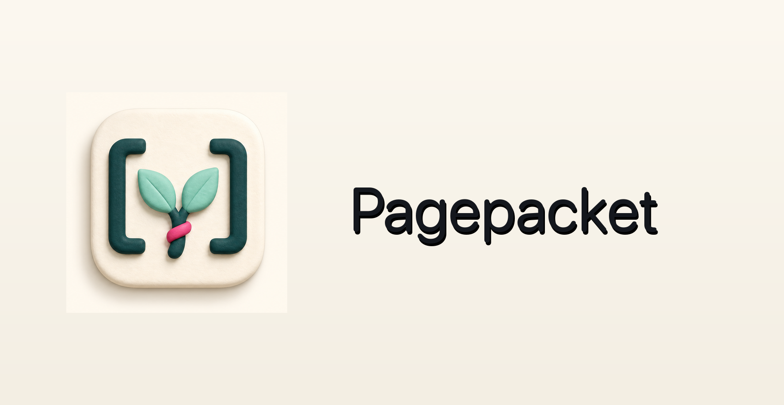

# pagepacket



pagepacket is a premium local-first Markdown editor for macOS. It keeps Markdown files as plain files on disk so people and coding agents can work in the same workspace.

## What is implemented

- SwiftUI macOS app with native sidebar, toolbar, inspector, and settings.
- Custom pagepacket app icon and logo assets in `Assets/Brand/`.
- Edit, Preview, and Split modes for Markdown files.
- Folder-based workspace loading from real `.md` files.
- Markdown preview for headings, paragraphs, lists, tasks, quotes, tables, code fences, links, horizontal rules, and local images.
- Local image import into an `assets/` folder with relative Markdown insertion.
- External file-change detection for agent edits.
- Local version snapshots in `.pagepacket/history/`.
- Restore from previous snapshots.
- Email invite intent UI saved to `.pagepacket/shares/invites.json`, with mail-client compose actions for invites.
- Agent activity and CLI sync contract surfaced in the inspector.
- `pagepacket-cli` commands for vault status, snapshots, apply checkpoints, and history.
- Repo-local agent skill at `skills/pagepacket-sync/SKILL.md`.
- Build/run integration for Codex Desktop through `.codex/environments/environment.toml`.

## Run

```bash
./script/build_and_run.sh
```

Verify launch:

```bash
./script/build_and_run.sh --verify
```

## CLI

```bash
swift run pagepacket-cli status SampleVault
swift run pagepacket-cli snapshot SampleVault welcome.md --message "Before agent edits"
swift run pagepacket-cli apply SampleVault welcome.md --author codex
swift run pagepacket-cli history SampleVault welcome.md
```

## Architecture

Plain Markdown files remain canonical. pagepacket adds a sidecar folder:

```text
vault/
  welcome.md
  assets/
  .pagepacket/
    history/
    shares/
```

This makes v1 agent-compatible without a backend. Real-time multiplayer, cloud sync, auth, and actual email delivery can layer onto the same document and revision model later.
